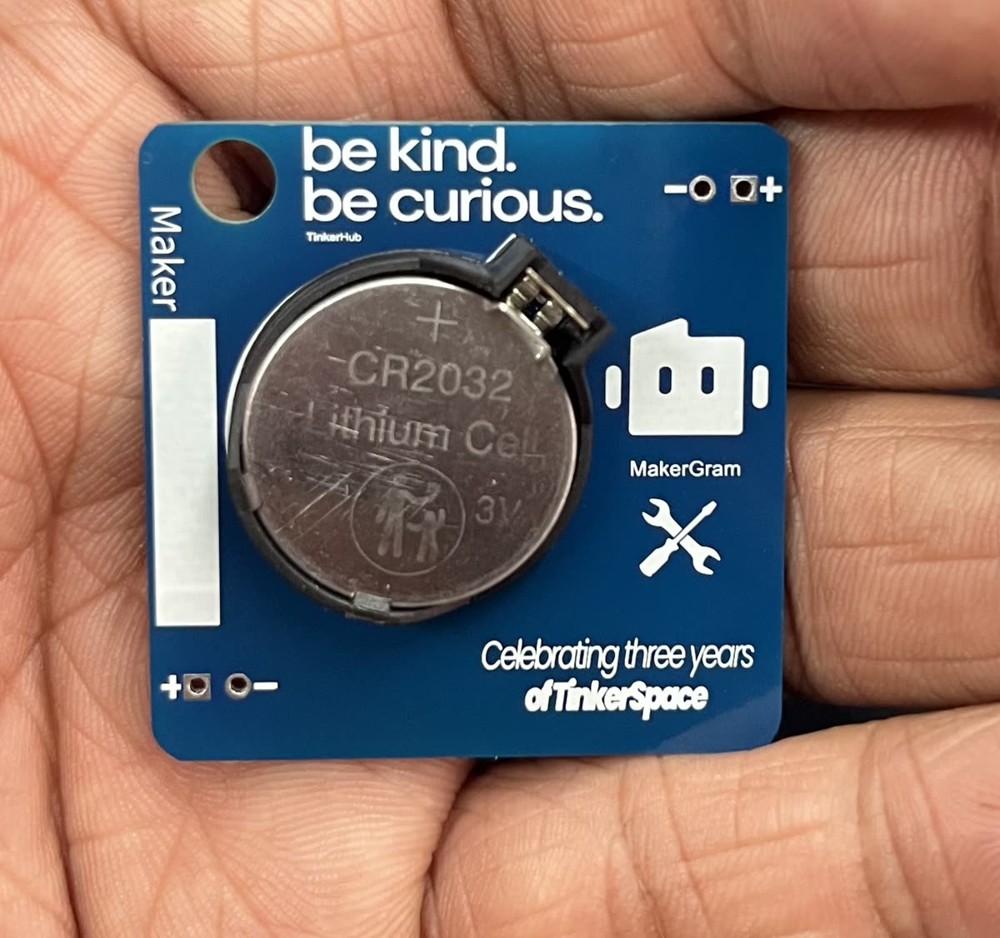
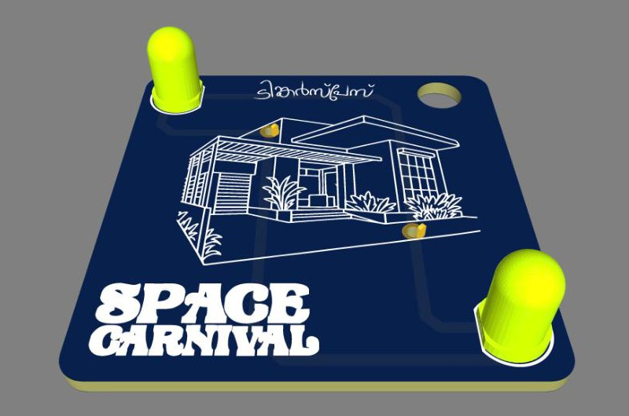
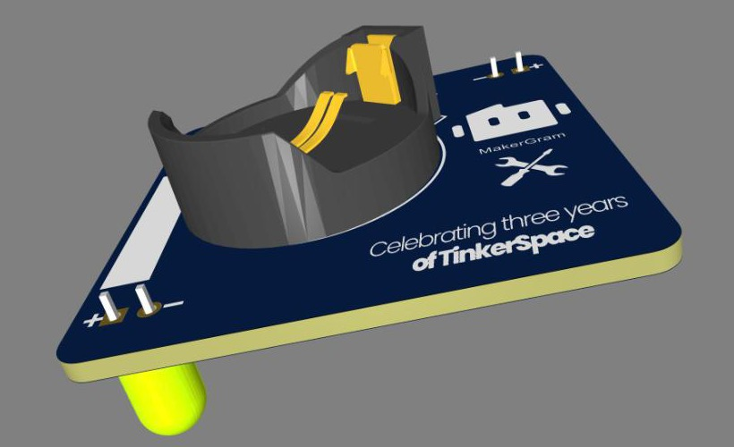
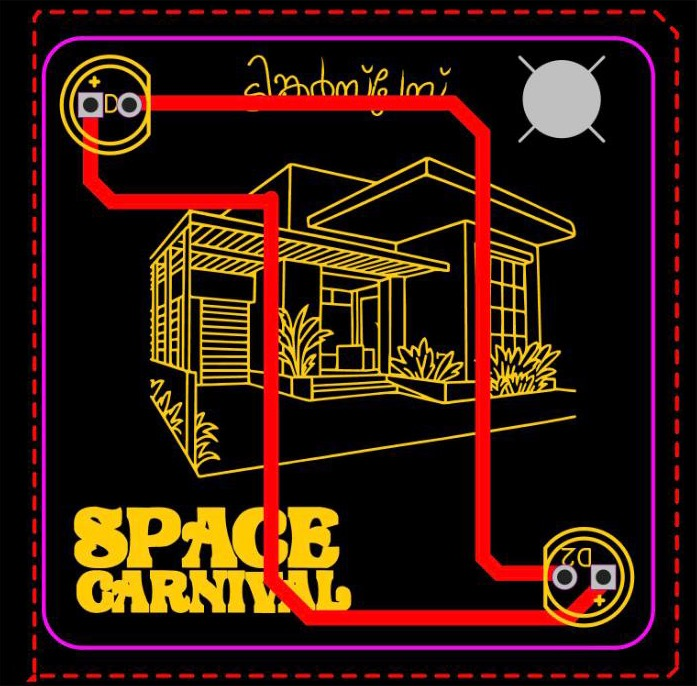
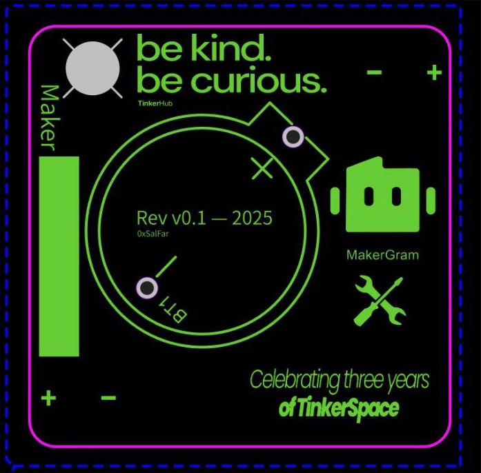
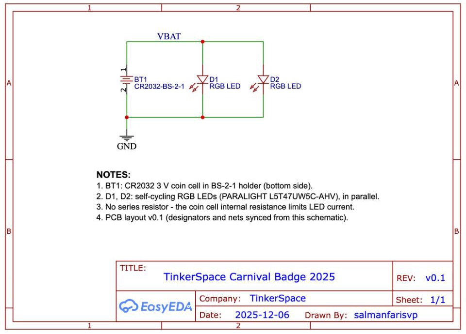

# TinkerSpace Carnival Badge 2025

The official PCB badge for the **2025 TinkerSpace Carnival**, celebrating **three years of TinkerSpace**.

It's a small, 40 × 40 mm art badge powered by a coin cell. A CR2032 on the back drives two colour-cycling LEDs on the front, set into the Space Carnival artwork.

**300 badges** were fabricated, kitted together with the community, and assembled by attendees at the Carnival. Read how it came together in **[STORY.md](STORY.md)**: the design, the paper fit check, the rush order and the factory-style kitting line.

<p align="center"></p>

## Documents

| What | File |
|---|---|
| The making-of story | [STORY.md](STORY.md) |
| Schematic (PDF) | [hardware/Schematic_Space-Carnival-Badge_v0.1.pdf](hardware/Schematic_Space-Carnival-Badge_v0.1.pdf) |
| Gerber files (fab-ready zip) | [hardware/gerber/Gerber_Space-Carnival-Badge_v0.1.zip](hardware/gerber/Gerber_Space-Carnival-Badge_v0.1.zip) |
| Bill of materials (CSV) | [hardware/BOM_Space-Carnival-Badge_v0.1.csv](hardware/BOM_Space-Carnival-Badge_v0.1.csv) |
| Pick-and-place / centroid (CSV) | [hardware/PickAndPlace_Space-Carnival-Badge_v0.1.csv](hardware/PickAndPlace_Space-Carnival-Badge_v0.1.csv) |
| EasyEDA source: schematic | [hardware/easyeda/Schematic_Space-Carnival-Badge_v0.1.json](hardware/easyeda/Schematic_Space-Carnival-Badge_v0.1.json) |
| EasyEDA source: PCB | [hardware/easyeda/PCB_Space-Carnival-Badge_v0.1.json](hardware/easyeda/PCB_Space-Carnival-Badge_v0.1.json) |
| Renders (schematic, layers, 3D) | [docs/images/](docs/images/) |

## Renders

| Front | Back |
|---|---|
|  |  |

<sub>3D renders from the EasyEDA 3D viewer. The fabricated boards are blue with white silkscreen; see [STORY.md](STORY.md) for photos of the real thing.</sub>

### Layout

| Top layer | Bottom layer (viewed from behind) |
|---|---|
|  |  |

---

## About TinkerSpace

**TinkerSpace** is a community-run makerspace in Kochi, Kerala, open 24×7. It's built by [TinkerHub](https://tinkerhub.org), Kerala's youth-led maker and learning community. Anyone can walk in to build, learn and tinker with tools like 3D printers, GPUs and VR kits, alongside the local maker community.

The badge carries TinkerSpace's spirit on its back: **"be kind. be curious."**

## About the Carnival

The [**TinkerSpace Carnival**](https://tinkerhub.substack.com/p/tinkerspace-carnival) (also called the *Space Carnival*) is TinkerSpace's yearly anniversary celebration. It's a community festival of demos, workshops, builds, music and people who make things. Each edition marks another year of the space being open. The 2025 edition celebrates **three years of TinkerSpace**, which is printed on the back of this badge.

This badge was designed for that event, as a wearable keepsake and a small, friendly intro to electronics: drop in a coin cell and it lights up.

---

## Hardware overview

| Item | Value |
|---|---|
| Board size | 40.0 × 40.0 mm, 2.5 mm corner radius |
| Layers | 2 (tracks on the top layer; no copper pour fill in the Gerbers) |
| Lanyard hole | Ø 5.0 mm, top corner |
| Trace width | 1.0 mm |
| Power | 1 × CR2032 (3 V lithium coin cell) |
| Revision | v0.1 (2025). No power switch, because the community is always on ([why](STORY.md#why-theres-no-off-switch)); remove the cell to turn it off |
| Quantity made | 300 (255 ordered, 300 delivered) |
| Fabricated by | [Lion Circuits](https://www.lioncircuits.com) (rush order: placed 9 Dec 2025, delivered 20 Dec 2025) |
| Cost | ≈ ₹52 per badge; ₹15,462 total ([breakdown](STORY.md#6-what-it-cost-and-who-sponsored-it)) |
| Sponsors | PCBs by [TinkerHub](https://tinkerhub.org), components by [MakerGram](https://makergram.com) |
| EDA tool | EasyEDA Standard |

### Schematic



The circuit is deliberately minimal:

- **BT1**: CR2032 coin cell in a BS-2-1 through-hole holder, mounted on the **bottom** side.
- **D1, D2**: 5 mm self-cycling RGB LEDs, mounted on the **top** side and wired in parallel across the cell (net `VBAT` → anodes, cathodes → `GND`).
- **No series resistor.** The internal resistance of a CR2032 limits the LED current. This is common on coin-cell badges, but it means you shouldn't power the badge from a bench supply or a USB 3.3 V/5 V rail without adding a resistor.

### Bill of materials

| Ref | Qty | Part | Package | LCSC |
|---|---|---|---|---|
| D1, D2 | 2 | PARALIGHT L5T47UW5C-AHV, RGB LED | LED-TH 5 mm (BD5.8, P2.54) | [C2981452](https://www.lcsc.com/product-detail/C2981452.html) |
| BT1 | 1 | QIJEY BS-2-1, CR2032 holder | BAT-TH_BS-2-1 | [C70376](https://www.lcsc.com/product-detail/C70376.html) |
| n/a | 1 | CR2032 coin cell | n/a | n/a |

**What we actually bought** for 300 badges: CR2032 cells at ₹5.80 each, coin-cell holders from [FlyRobo](https://www.flyrobo.in) at ₹3.04, and LEDs from New Digital Electronics (Nilambur) at ₹2. That's ₹12.84 in parts per badge. See the [cost breakdown](STORY.md#6-what-it-cost-and-who-sponsored-it).

> The schematic was cleaned up after layout: designators were renamed to D1/D2/BT1 and the nets are named `VBAT` and `GND`. These changes were pushed to the PCB with *Update PCB*. The placement, routing and artwork were not changed.

### Artwork

**Front (top silkscreen):** the *Space Carnival* logotype, a line-art illustration of the space, and lettering across the top. The two LEDs sit in the top-left and bottom-right corners.

**Back (bottom silkscreen):**
- "be kind. be curious." with the TinkerHub mark
- MakerGram logo
- A **"Maker"** write-on block: a solid silkscreen strip for writing your name. Many people soldered for the first time on this badge, so once it's built you're officially a Maker and the badge is your certificate ([story](STORY.md#your-badge-is-your-maker-certificate))
- "Celebrating three years of TinkerSpace"
- Revision stamp `Rev v0.1 — 2025` and designer handle `0xSalFar`
- Coin-cell holder outline with `+` / `−` markings

---

## Assembly

1. Solder **D1** and **D2** from the **top** side. Match the LED flat/short leg (cathode) to the round pad; the square pad (`+`) is the anode.
2. Solder the **BS-2-1 coin-cell holder** on the **bottom** side.
3. Trim the leads flush on the back so they don't scratch clothing.
4. Insert a CR2032 following the `+` marking on the holder. Both LEDs should start cycling colours.
5. Write your name on the **Maker** strip. You're officially a Maker now!
6. Thread a lanyard through the hole and wear it.

> **Open and hackable:** the LEDs don't have to go on the front. People soldered them on the other side, at angles, or however they liked. Make the badge your own. ([story](STORY.md#open-and-hackable))

## Design files

All fabrication and source files are in [`hardware/`](hardware/):

```
hardware/
├── Schematic_Space-Carnival-Badge_v0.1.pdf      # printable schematic
├── BOM_Space-Carnival-Badge_v0.1.csv            # bill of materials (LCSC part numbers)
├── PickAndPlace_Space-Carnival-Badge_v0.1.csv   # component centroids / rotation
├── gerber/
│   └── Gerber_Space-Carnival-Badge_v0.1.zip     # upload this to your PCB fab
└── easyeda/
    ├── Schematic_Space-Carnival-Badge_v0.1.json # EasyEDA Standard source
    └── PCB_Space-Carnival-Badge_v0.1.json       # EasyEDA Standard source
```

- **To order boards:** upload the Gerber zip to any PCB fab. Use 2 layers, 1.6 mm FR-4, a 40 × 40 mm board, blue solder mask and white silkscreen to match the original.
- **To edit the design:** in [EasyEDA Standard](https://easyeda.com/editor), go to *File → Open → EasyEDA Source* and open the JSON files.
- The original project lives in EasyEDA as **Space-PCB-Badge v0.1** (`Sheet_1` + `PCB_Space-PCB-Badgev0.1`).
- The images in `docs/images/` were rendered directly from the EasyEDA design.

## Credits

- Badge design: Salman Faris (`0xSalFar`)
- Made for the TinkerSpace community, Kochi
- Thanks to all the TinkerSpace community members who helped and motivated this project (see [STORY.md](STORY.md#thank-you))
- Kitted by TinkerSpace community volunteers (see [STORY.md](STORY.md))
- PCBs fabricated by [Lion Circuits](https://www.lioncircuits.com), **sponsored by [TinkerHub](https://tinkerhub.org)**
- Components **sponsored by [MakerGram](https://makergram.com)**: holders from [FlyRobo](https://www.flyrobo.in), LEDs from New Digital Electronics, Nilambur
- Logos on the board belong to their respective communities (TinkerHub, TinkerSpace, MakerGram)

## License

Released under the [MIT License](LICENSE).
