# The Story: Making 300 Badges for the TinkerSpace Carnival

How the 2025 TinkerSpace Carnival badge went from an EasyEDA file to 300 kits, built together with the community.

[← Back to README](README.md)

---

## 1. Design

The badge was designed in **EasyEDA**: a 40 × 40 mm board, two colour-cycling LEDs and a CR2032 coin cell. The circuit is as simple as it gets, so most of the design time went into the **artwork**:

- **Front:** the *Space Carnival* logotype and a line drawing of the space.
- **Back:** *"be kind. be curious."*, the MakerGram logo, a *Maker* name strip and *"Celebrating three years of TinkerSpace"*.

The schematic, layout and fabrication files are in [`hardware/`](hardware/).

## 2. Paper fit check

Before spending money on boards, we printed both sides of the PCB **1:1 on paper**. A coin cell placed on the printout let us confirm that:

- the overall board size felt right as a badge,
- the CR2032 and its holder fit inside the outline,
- the LEDs, the lanyard hole and the artwork didn't collide.

It's the cheapest prototype there is, and it catches the most expensive mistakes.

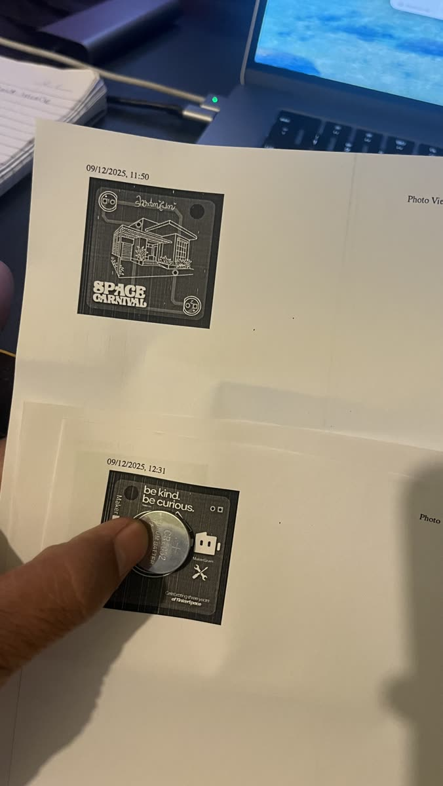

## 3. Rush order from Lion Circuits

With the size confirmed, we placed a **rush order for 300 PCBs** with [Lion Circuits](https://www.lioncircuits.com), an Indian PCB fab, so the boards would arrive in time for the Carnival.

| Delivery | Unboxing |
|---|---|
| 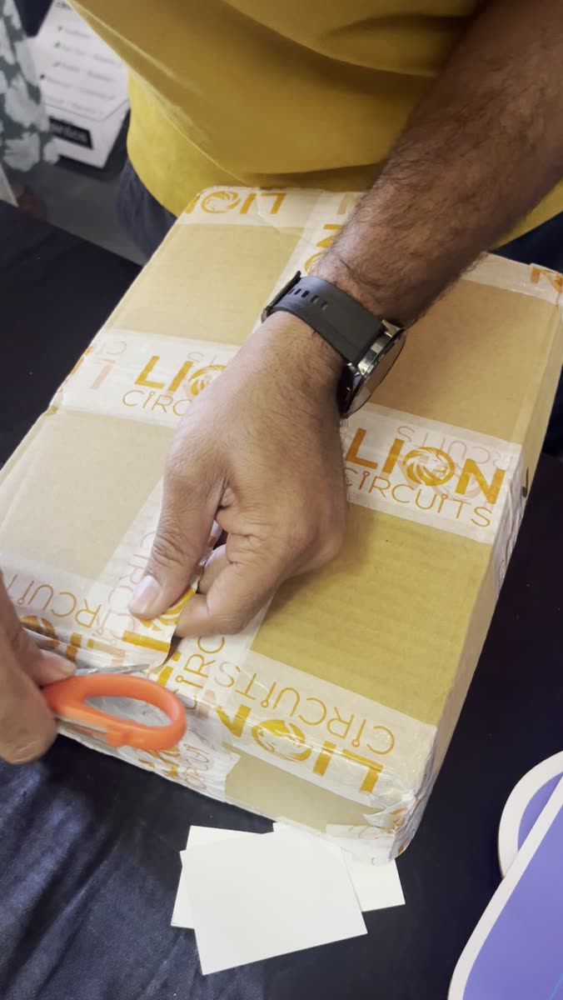 | 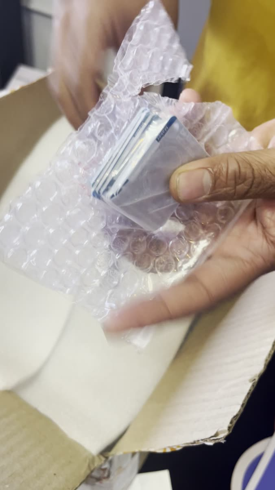 |

The boards arrived blue with white silkscreen, just as designed:

| Front | Back | Back, with the cell |
|---|---|---|
| 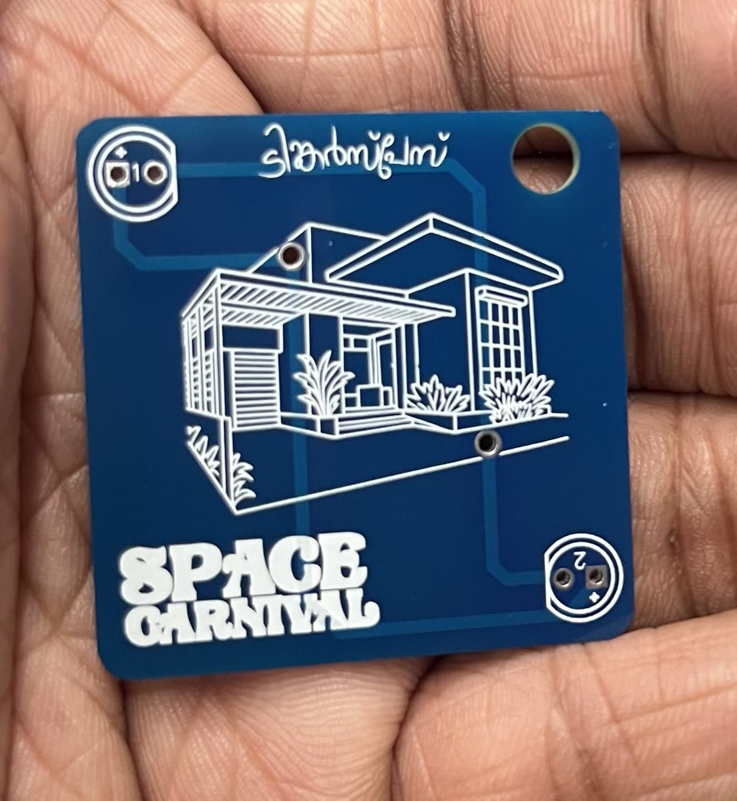 | 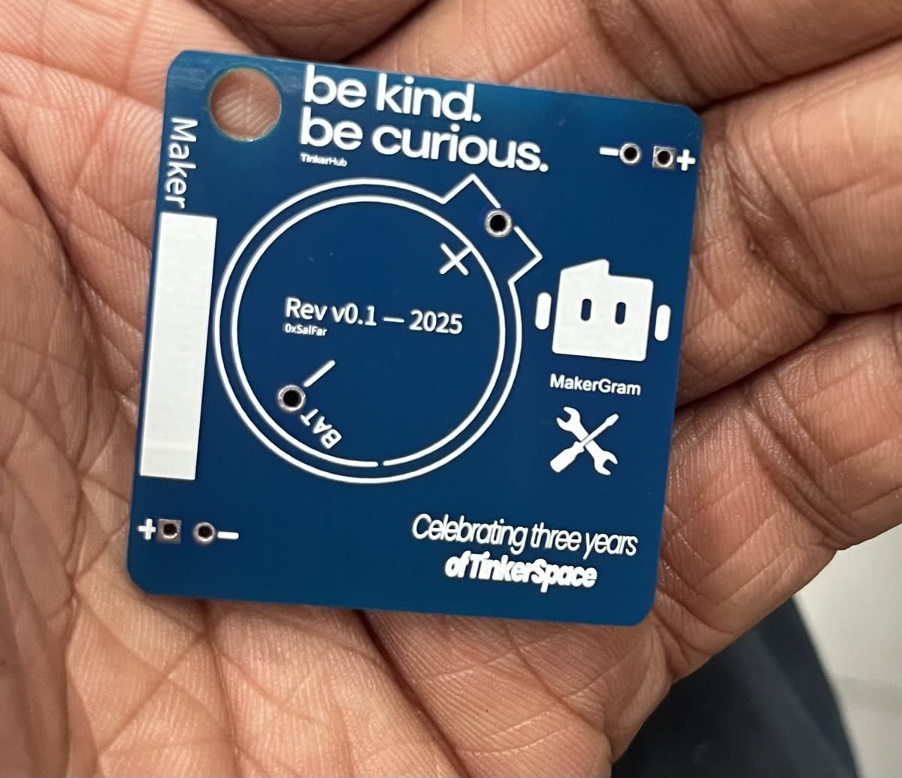 | 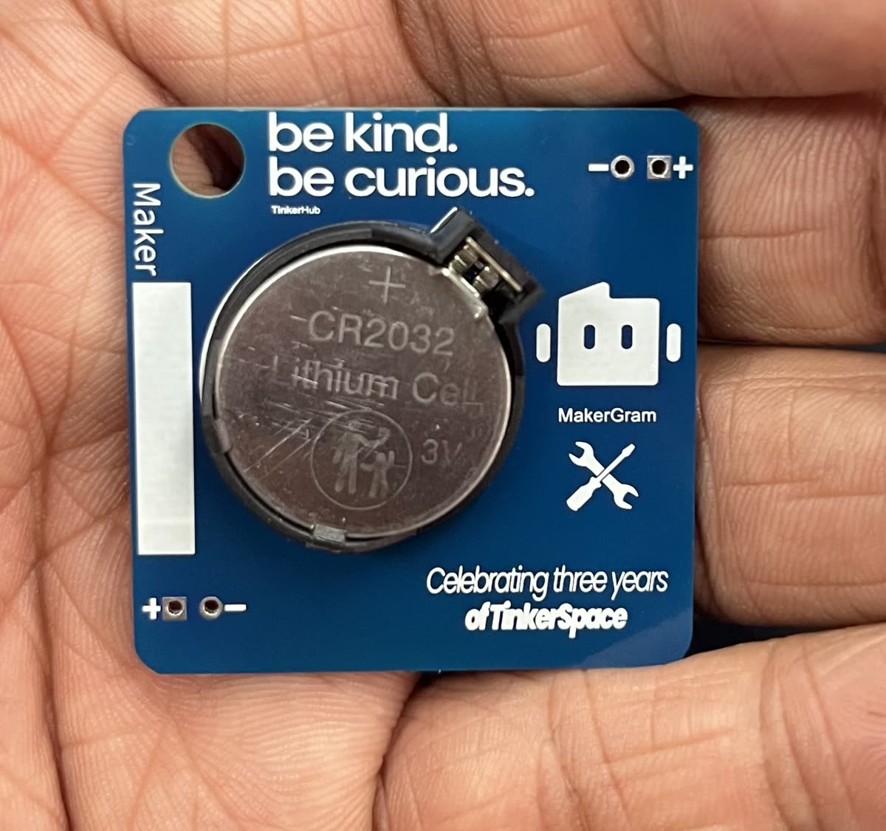 |

The CR2032 coin cells were sourced in bulk alongside the boards:

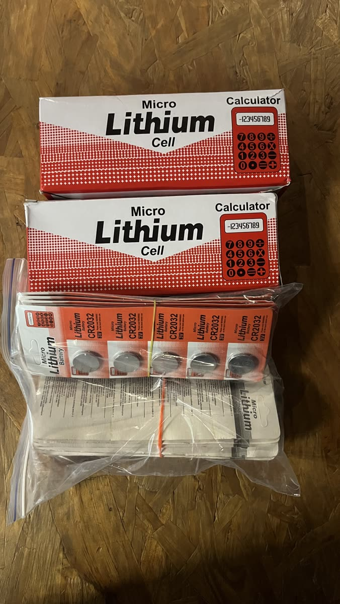

## 4. Kitting with the community, factory style

300 kits is a lot of tiny parts. Instead of packing them alone, we turned it into a **community build session** at TinkerSpace, set up like a small factory line:

1. **Briefing:** everyone gathered to go over the kit contents and how the line would run.
2. **Assembly line:** volunteers sat around the table, and **each person added one part to the kit**: a PCB, the LEDs, the coin-cell holder, a CR2032.
3. **Done:** each bag moved down the table, and what came off the end was a **complete kit**.

It was faster, it was more fun, and everyone who helped had a hand in every badge.

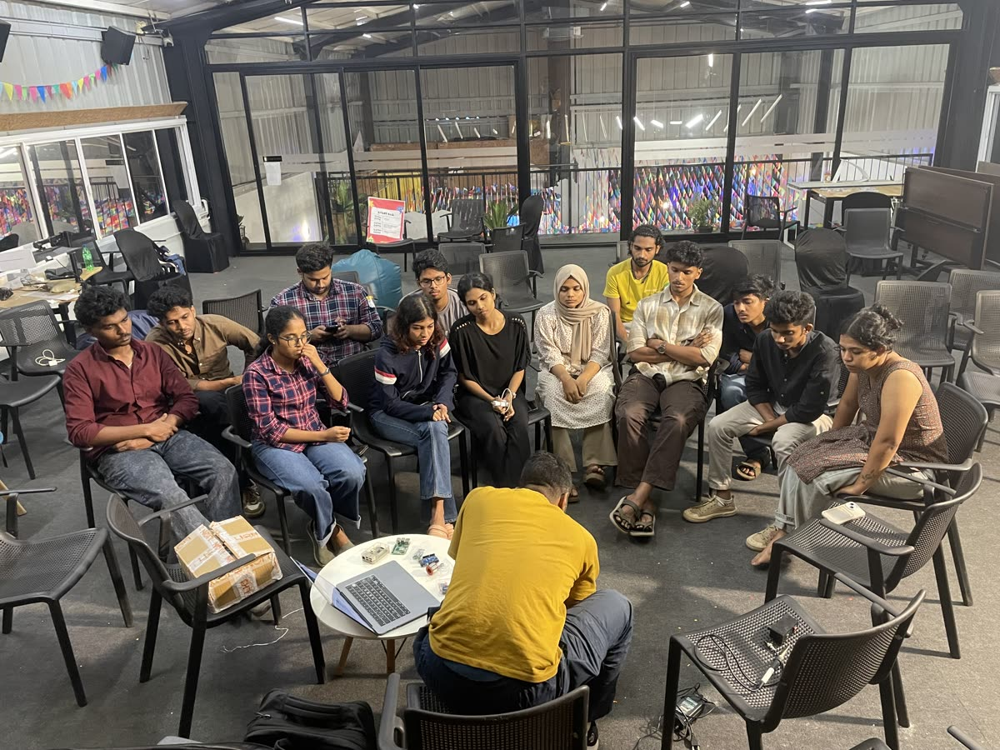

| The line in action | Factory-style setup |
|---|---|
| 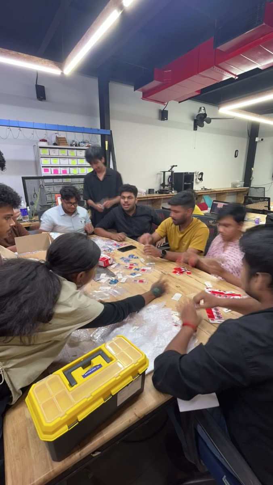 | 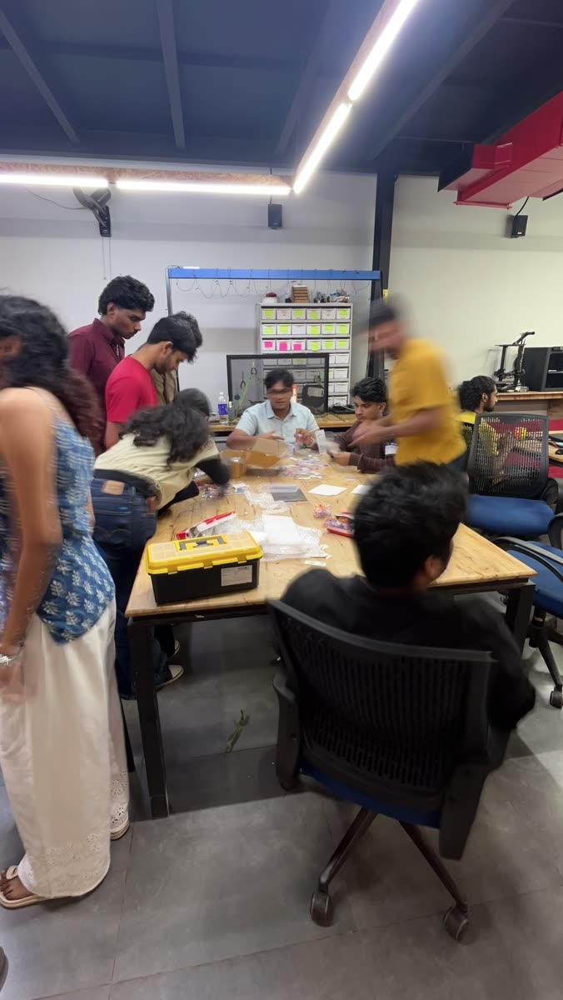 |

## 5. Soldering the badges

At the soldering station, the kits turned into working badges: two LEDs on the front, the coin-cell holder on the back, a CR2032 in, and the badge lights up.

| | | |
|---|---|---|
| 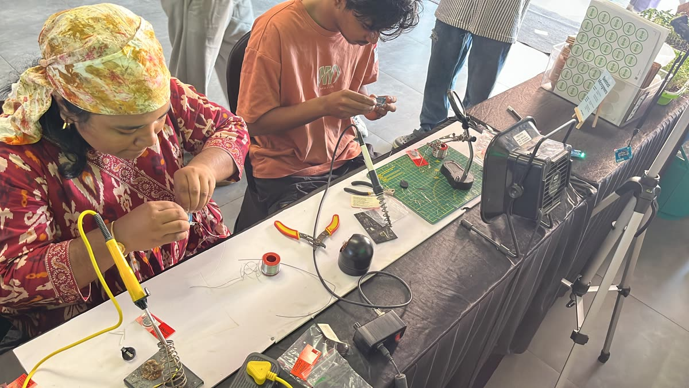 | 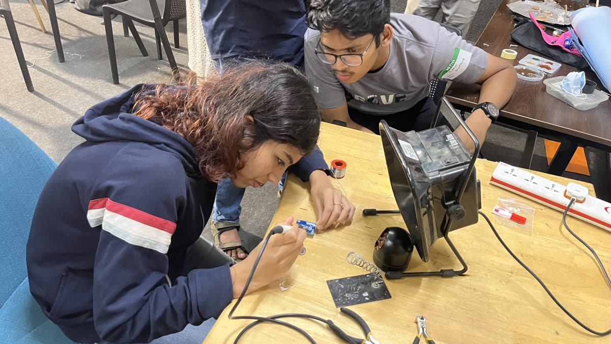 | 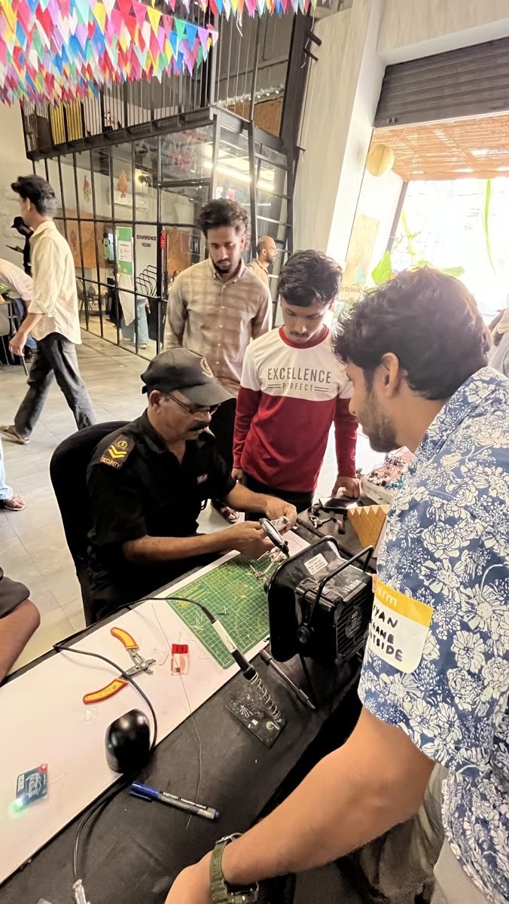 |

---

## Timeline at a glance

| Step | What happened |
|---|---|
| Design | Schematic and PCB in EasyEDA (Dec 2025) |
| Verify | 1:1 paper printout to check board, cell and holder size |
| Fabricate | Rush order of **300 PCBs** from Lion Circuits |
| Kit | Community, factory-style kitting line at TinkerSpace |
| Build | Badges soldered and powered up with a CR2032 |

## Lessons for the next badge

- **Print it 1:1 first.** A paper printout and the real parts on top catch sizing mistakes for free.
- **Order early, or plan for a rush order.** Fab and shipping time is usually the tightest part of an event badge.
- **Make kitting a community event.** A one-part-per-person line is quick, and it gets more people involved in the badge.
- **Keep the circuit simple.** Two LEDs and a coin cell are easy for first-timers to solder and hard to get wrong.
