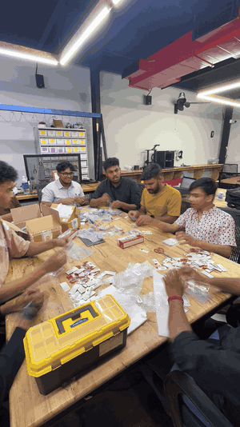
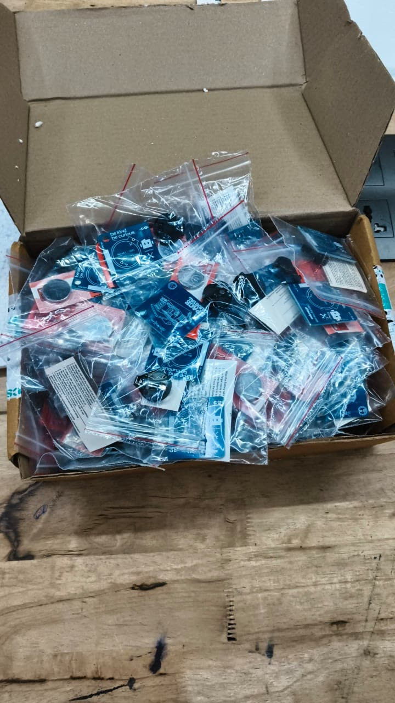
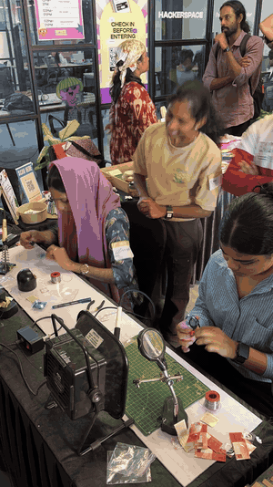

# The Story: Making 300 Badges for the TinkerSpace Carnival

How the 2025 TinkerSpace Carnival badge went from an EasyEDA file to 300 kits, built together with the community.

[← Back to README](README.md)

---

## 1. Design

The badge was designed in **EasyEDA**: a 40 × 40 mm board, two colour-cycling LEDs and a CR2032 coin cell. The circuit is as simple as it gets, so most of the design time went into the **artwork**:

- **Front:** the *Space Carnival* logotype and a line drawing of the space.
- **Back:** *"be kind. be curious."*, the MakerGram logo, a *Maker* name strip and *"Celebrating three years of TinkerSpace"*.

The schematic, layout and fabrication files are in [`hardware/`](hardware/).

## 2. Paper fit check

Before spending money on boards, we printed both sides of the PCB **1:1 on paper**. A coin cell placed on the printout let us confirm that:

- the overall board size felt right as a badge,
- the CR2032 and its holder fit inside the outline,
- the LEDs, the lanyard hole and the artwork didn't collide.

It's the cheapest prototype there is, and it catches the most expensive mistakes.

## 3. Rush order from Lion Circuits

With the size confirmed, on **9 December 2025** we placed a **rush order for 255 PCBs** with [Lion Circuits](https://www.lioncircuits.com), an Indian PCB fab in Bengaluru, so the boards would arrive in time for the Carnival. The boards arrived on **20 December 2025**, just 11 days later, and Lion Circuits delivered **300 boards**. The PCBs were sponsored by **TinkerHub** (see [what it cost](#6-what-it-cost-and-who-sponsored-it)).

| Delivery | Unboxing |
|---|---|
|  |  |

The boards arrived blue with white silkscreen, just as designed:

| Front | Back | Back, with the cell |
|---|---|---|
|  |  |  |

The parts were sponsored by **MakerGram**: CR2032 cells, coin-cell holders from FlyRobo, and LEDs from New Digital Electronics, a local electronics shop in Nilambur. Here are the CR2032 cells:

## 4. Kitting with the community, factory style

300 kits is a lot of tiny parts. Instead of packing them alone, we turned it into a **community build session** at TinkerSpace, set up like a small factory line:

1. **Briefing:** everyone gathered to go over the kit contents and how the line would run.
2. **Assembly line:** volunteers sat around the table, and **each person added one part to the kit**: a PCB, the LEDs, the coin-cell holder, a CR2032.
3. **Done:** each bag moved down the table, and what came off the end was a **complete kit**.

It was faster, it was more fun, and everyone who helped had a hand in every badge.

   
  Time-lapse of the kitting line: each person adds one part, and a complete kit comes out at the end. <a href="docs/story/kitting-time-lapse.mp4">Watch the full-quality MP4</a>

The result was a box full of ready-to-build kits. Each bag holds a PCB, two LEDs, the coin-cell holder, a CR2032 and an instruction card:

## 5. Assembling the badges at the Carnival

At the Carnival, people brought their kits to the soldering station and assembled their own badges: two LEDs on the front, the coin-cell holder on the back, a CR2032 in, and the badge lights up. For many it was their first time soldering.

   
  Badge assembly at the Carnival soldering station (sped up). <a href="docs/story/soldering-at-carnival.mp4">Watch the full-quality MP4 with sound</a>

| | | |
|---|---|---|
|  |  |  |

### Your badge is your Maker certificate

On the back of the badge there's a blank **"Maker"** strip, and it's there on purpose.

A lot of people made their **first-ever solder joint** on this badge: school and college students, and community members from completely different fields who had never held a soldering iron before. We wanted to acknowledge that moment. Once you've soldered your badge, you're **officially a Maker**, and the badge is your certificate. That's why there's a space to write your name on it.

### Open and hackable

There's no "right" way to build it. The design puts the LEDs on the front, but we saw people solder them on the **other side**, at different angles, or however they liked, and that's absolutely fine. The badge is about creativity and making it your own, so it's **open and hackable** by design.

### Why there's no off switch

You'll notice there's no power switch. Here's the official reason. 😄

The coin cell sits right behind the **TinkerSpace** artwork, so TinkerSpace is the **powerhouse**. The two LEDs are the **people and their ideas**. The space and the community power them, and that power is never meant to be switched off. **TinkerSpace and its community are always on.**

(It's definitely, absolutely *not* because a switch would have blown the budget. 😉)

---

## Timeline at a glance

| Step | What happened |
|---|---|
| Design | Schematic and PCB in EasyEDA (early Dec 2025) |
| Verify | 1:1 paper printout to check board, cell and holder size |
| Order | **9 Dec 2025**: rush order of 255 PCBs placed with Lion Circuits |
| Delivery | **20 Dec 2025**: **300 boards** delivered, 11 days after ordering |
| Kit | Community, factory-style kitting line at TinkerSpace: 300 complete kits |
| Build | Attendees assembled their badges at the Carnival soldering station |
| Cost | ₹15,462 in total: PCBs ₹11,790 (TinkerHub), parts ₹3,672 (MakerGram) |

## 6. What it cost, and who sponsored it

The **PCBs were sponsored by [TinkerHub](https://tinkerhub.org)**, and the **components were sponsored by [MakerGram](https://makergram.com)**.

### PCBs: Lion Circuits (sponsored by TinkerHub)

We ordered **255 boards** as a rush order, and Lion Circuits delivered **300**.

| Item | Qty | Rate (₹) | Amount (₹) |
|---|---:|---:|---:|
| PCB fabrication (*TinkerSpace-SpaceCarnival-Badge-v01*) | 255 | 28.23 | 7,197.89 |
| Fabrication NRE charges | 1 | 2,200.00 | 2,200.00 |
| Outward shipping | 1 | 593.22 | 593.22 |
| **Subtotal** | | | **9,991.11** |
| IGST 18% | | | 1,798.40 |
| Rounding | | | 0.49 |
| **Total** | | | **₹11,790.00** |

Lion Circuits invoice LCY2B526AD404140, dated 17 Dec 2025.

### Components (sponsored by MakerGram)

| Part | Source | Qty | Rate (₹) | Amount (₹) |
|---|---|---:|---:|---:|
| CR2032 coin cell | | 300 | 5.80 | 1,740.00 |
| CR2032/CR2025 coin-cell holder | [FlyRobo](https://www.flyrobo.in) | 300 | 3.04 | 912.00 |
| 5 mm colour-cycling RGB LED | New Digital Electronics, Nilambur (local shop) | 510 | 2.00 | 1,020.00 |
| **Total** | | | | **₹3,672.00** |

### Totals

| | Amount (₹) |
|---|---:|
| PCBs (TinkerHub) | 11,790.00 |
| Components (MakerGram) | 3,672.00 |
| **Grand total** | **₹15,462.00** |

That works out to about **₹39 per board** (₹11,790 over the 300 boards delivered) plus **₹12.84 in parts per badge** (cell ₹5.80, holder ₹3.04, 2 × LED ₹2). That's roughly **₹52 per badge**.

---

## Lessons learned

The schedule was tight, so the top priority was simple: **get the badge designed, fabricated and into people's hands in time for the Carnival.** That meant some things we would normally do got left out.

### What worked

- **Print it 1:1 first.** A paper printout with the real parts on top catches sizing mistakes for free.
- **Make kitting a community event.** A one-part-per-person line is quick, and it gets more people involved in the badge.
- **Keep the circuit simple.** Two LEDs and a coin cell are easy for first-timers to solder and hard to get wrong.

### What we missed, and would do next time

- **No power switch.** The community is always on ([see why](#why-theres-no-off-switch) 😄), but practically, once a cell is in, the LEDs run until the battery drains, and the only way to turn the badge off is to pop the cell out. A small slide switch or a tactile button would be a nice addition in the next revision.
- **No panelization.** The boards were ordered as single 40 × 40 mm pieces. Panelizing them, with several badges per panel joined by V-cuts or mouse-bites, would have lowered the per-board cost and made kitting and handling faster.
- **Plan earlier.** Ordering earlier would have avoided the rush order and left time for a proper prototype round before the full run.

---

## Thank you

A huge thank you to the **TinkerSpace community members** who helped and motivated this project. Everyone was super supportive throughout the whole process, from the first paper printout and the kitting line to the soldering table at the Carnival.

Thanks as well to **TinkerHub** for sponsoring the PCBs and **MakerGram** for sponsoring the components.

> I'm so proud and happy every time I see someone wearing the badge and using it. 💙
> — Salman Faris
